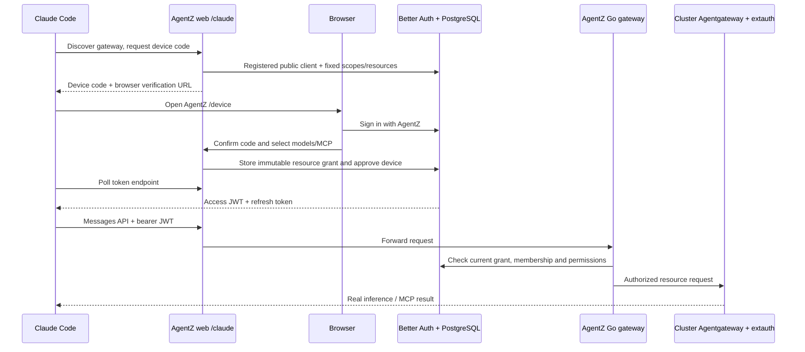

The current Codex PoC is documented in [codex/README.md](codex/README.md). The Claude report below is retained as the baseline investigation.

# Claude Code gateway PoC

This branch proves native Claude Code login against AgentZ, user-bound inference, refresh, revocation, and MCP access. It is throwaway code based on `feat/external-agents` at `e674df00`.

The tested native login uses a private loopback endpoint. It does not meet the later requirement for native AgentZ login and refresh against public `https://agentzharness.ai` with only Claude installed and no proxy or helper. The actual client rejects that public host before device authorization. See [the SaaS feasibility investigation](public-saas-research.md) and [the rejection evidence](evidence/native-public-login-result.json).

Claude Code 2.1.299 was tested against the existing Kind cluster and its Anthropic provider. The real CLI returned `CLAUDE_AGENTZ_NATIVE_OK` through AgentZ inference. A fresh CLI process called the delegated MCP echo tool and returned `AgentZ MCP: CLAUDE_MCP_NATIVE_OK`. After the original access token expired, the CLI refreshed it and returned `POC_NATIVE_REFRESH_OK`.

The protocol and deployment constraints are documented in [the research notes](claude-code-research.md), with links to Anthropic's documentation and the inspected native release. Native gateway login expects a private endpoint by default. Loopback HTTP works for this PoC; a deployed gateway needs private HTTPS.

## What runs



| Gateway path | Behavior |
| --- | --- |
| `/claude/.well-known/oauth-authorization-server` | Native gateway discovery |
| `/claude/oauth/device_authorization` | RFC 8628 request, with Claude's missing client ID and scopes supplied by AgentZ |
| `/device` | Existing AgentZ login, explicit code confirmation and resource approval |
| `/claude/oauth/token` | Device redemption and rotating refresh tokens |
| `/claude/oauth/revoke` | Revoke the underlying grant so issued JWTs stop working immediately |
| `/claude/v1/messages` | Authorized Anthropic Messages, including SSE |
| `/claude/v1/messages/count_tokens` | Authorized Anthropic token counting |
| `/claude/v1/models` | Anthropic-shaped list of selected models |
| `/claude/mcp` | Existing delegated MCP gateway |
| `/claude/managed/settings` | Authenticated 404, meaning no managed policy |
| `/claude/v1/metrics`, `/claude/v1/logs`, `/claude/v1/traces` | Authenticate, then discard telemetry |

Device requests are bound to a public OAuth client. Claude sends neither `client_id` nor `scope`. AgentZ supplies `openid profile email offline_access inference:use mcp:use` and the inference/MCP resource audiences. Access tokens last 600 seconds, refresh tokens last 30 days, and concurrent refreshes have a 10 second replay window.

The small Better Auth dependency patch carries the selected grant reference and browser session from the device record into token issuance. Without it, a device token would lose the resource grant needed by the existing gateway checks. The ordinary authorization-code flow retains its previous settings.

The Go gateway accepts both full AgentZ model IDs and unique Anthropic model names. It rejects ambiguous aliases. Messages are restricted to Anthropic and Anthropic-compatible providers in this PoC. Provider files, hosted MCP, containers and hosted tools are rejected because a model grant does not authorize those provider-account resources.

## Run it

Use a separate database whose name contains `poc`. The setup and test scripts refuse the ordinary application database.

1. Create a PostgreSQL database and apply the existing web schema, then `web/db/migrations/0004_claude_device_poc.sql`. For an existing migrated PoC database, run the normal Drizzle migrations instead. Apply the Go migrations with `agentz migrate --postgres-dsn "$DATABASE_URL"` from the repository root.
2. Copy the existing web environment to this worktree. Set `DATABASE_URL` to the PoC database, `BETTER_AUTH_URL=http://localhost:3000`, `GATEWAY_BASE_URL=http://localhost:8090`, `INTERNAL_GATEWAY_BASE_URL=http://localhost:8090`, and `ENABLE_CLAUDE_GATEWAY_POC=true`. Enable credential authentication and allow the dedicated test email. Existing asset settings and auth secrets are still required.
3. Run `bun install` and `bun run dev --hostname 0.0.0.0` from `web`. Create the test account through AgentZ sign-up. Then run the setup script against an existing ready Workspace resource.

```sh
cd web
bun scripts/claude-poc-setup.ts ws-7d31628b9be6033365a9fab012db672d claude-poc@example.com
```

The tested Workspace belongs to organization `56b53bdecd1d7c891531f2a6c28e1cd1`. Its ID is `29b9801e20306cd607f3c4c0af9105b2`. The setup script seeds that existing workspace's identity in the isolated database, grants the test user a PoC admin role, enables delegation and registers the public Claude client. It does not print secrets.

Build the Go binary with `CGO_ENABLED=0 go build -o /tmp/agentz-claude-poc ./cmd/agentz`. The cluster's authorization container needs a static executable. Use the existing gateway runtime configuration, with the PoC database, issuer and JWKS URL. This host used the following private services.

```sh
kubectl -n agentz-manual-delegations port-forward svc/delegations 18080:8080
kubectl -n openbao port-forward svc/openbao 18200:8200
kubectl -n default create token default --duration=24h > /tmp/claude-poc-sa-token
chmod 600 /tmp/claude-poc-sa-token
```

The Go gateway ran on `127.0.0.1:8090` with `--delegation-namespace=agentz-manual-delegations`, `--delegation-gateway-url=http://127.0.0.1:18080`, the default ServiceAccount in the default namespace, issuer `http://localhost:3000`, JWKS URL `http://localhost:3000/api/auth/.well-known/jwks.json`, and audience `agentz-gateway`. OpenBao used `http://127.0.0.1:18200`, mount `kv`, role `gateway`, and the token file above. Supply the existing skills bucket configuration as for `make run-gateway`.

The owner namespace's `extauth` deployment must run the PoC binary to admit Messages requests. This test used image `agentz-claude-poc:ca`, built from the existing `agentz-manual:astra-reviewed` image with the static binary and the manual upstream CA added to its trust bundle.

## Native Claude configuration

Use an isolated profile so the PoC does not replace a developer's ordinary login.

```json
{
  "forceLoginMethod": "gateway",
  "forceLoginGatewayUrl": "http://localhost:3000/claude",
  "model": "claude-haiku-4-5-20251001",
  "env": { "CLAUDE_CODE_ENABLE_GATEWAY_MODEL_DISCOVERY": "1" }
}
```

Save this as `$CLAUDE_CONFIG_DIR/settings.json`. Run Claude Code 2.1.299, enter `/login`, trust the loopback gateway, and sign in at AgentZ. Confirm the displayed code and select the Anthropic models and MCP connection. The CLI then asks the user to confirm the signed-in account before saving credentials.

MCP uses the gateway credential through `headersHelper`. The helper is specific to the tested Linux file-based credential store. It reads the native credential, rejects expired credentials, and emits the authorization header only to the MCP client.

```json
{
  "mcpServers": {
    "gateway": {
      "type": "http",
      "url": "http://localhost:3000/claude/mcp",
      "headersHelper": "node /absolute/path/to/agentz/web/scripts/claude-poc-mcp-headers.mjs"
    }
  }
}
```

Restart Claude after adding MCP configuration or changing the selected resources so it reloads the tool catalog. The native proof used a fresh process with `--strict-mcp-config --mcp-config /tmp/claude-poc-project/.mcp.json --allowedTools 'mcp__gateway__*'`.

## MCP fixture

The existing `shared-mcp` connection pointed to a stopped manual-test server at `https://172.18.0.1:19320/org/mcp`. `cmd/claude-poc-upstream` restores that endpoint using the existing manual TLS certificate and bearer credential from OpenBao. It exposes `echo`, `private_echo`, `poc_greeting`, and `agentz-poc://status`. The server verifies the upstream bearer, which proves the gateway injected the resource owner's credential.

```sh
go build -o /tmp/claude-poc-upstream ./cmd/claude-poc-upstream
POC_MCP_BEARER='<existing upstream token>' /tmp/claude-poc-upstream \
  --cert /tmp/claude-poc-cert.pem --key /tmp/claude-poc-key.pem
```

The OpenBao record's `credentials` field contains JSON with a `token` field. Use that token value. The fixture certificate, key and CA came from `manual-upstream` in `agentz-manual`. The authorization image trusts that CA. This host's firewall needed a temporary rule allowing only the Kind node, `172.18.0.2`, to reach `172.18.0.1:19320` through its Docker bridge.

## Verification

The live checks use the running web and Go gateways, the real Anthropic provider, native Agentgateway routes, OpenBao credential injection, and the restored MCP server.

```sh
cd web
bun scripts/claude-poc-device-checks.ts /tmp/claude-poc-cookies ../docs/poc/evidence/manual-device-results.json
bun --conditions=react-server scripts/claude-poc-checks.ts /tmp/independently-approved-tokens.json ../docs/poc/evidence/manual-api-results.json
bun --conditions=react-server scripts/claude-poc-mcp-checks.ts "$CLAUDE_CONFIG_DIR/.credentials.json" ../docs/poc/evidence/manual-mcp-results.json
```

Use a separate device grant for the inference checks. That script revokes its test grant. A refresh token belongs to its native CLI profile; copying and rotating it from an unrelated client can trigger replay protection.

The MCP checks create a separate restricted grant fixture in the PoC database. They check exact tool, prompt and resource permissions and reject an MCP session used with a different grant. They remove that fixture after the test.

See [the manual test report](manual-testing.md), [browser approval evidence](evidence/device-approval-mcp.png), and [the native Claude result](evidence/native-claude-result.json).

## Runtime changes and cleanup

Local PoC resources are PostgreSQL container `agentz-claude-poc-postgres` on port 25432, web on port 3000, Go gateway on port 8090, private port-forwards on 18080 and 18200, MCP fixture on 19320, and isolated Claude/browser profiles under `/tmp/claude-poc-*`. Credentials remain in private local files and are excluded from the branch.

To clean up, revoke or delete the PoC grants while the Go gateway is running so it removes their cluster projections. Restore the owner namespace's authorization image to `agentz-manual:astra-reviewed`, stop the PoC processes and port-forwards, and remove the PoC database container and its volume. Remove the firewall rule labeled `agentz-claude-poc`.

Testing also required enabling the host's existing `/root/agentz-e2e.swap`, adding `/root/agentz-claude-poc-extra.swap` and limiting the existing `postgres` container to one CPU. The original CPU-heavy process with host PID 414443 was paused. These host changes are separate from the PoC application resources.

The extra swap file can be removed with `swapoff /root/agentz-claude-poc-extra.swap` followed by deleting that file after memory pressure has subsided.
