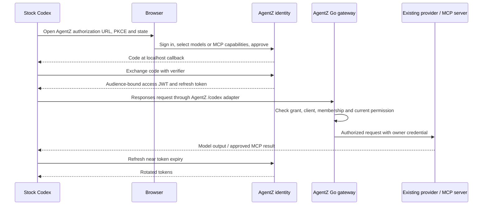

# Codex governance PoC

Stock Codex 0.162.1 can authenticate directly to public AgentZ, store and refresh its own credentials, and use AgentZ for inference and MCP. The tested model is the existing Anthropic connection, `ip-245104a51f5f`, using Claude Haiku 4.5. There is no installed AgentZ helper, client-side proxy, API key, or token resolver. The client source is checked out under `.ref/codex` at release commit `092d3acd6bec3e3a14bdc7e7a2810ab628ab759d`.

The dedicated branch is `poc/codex-governance`, based on the Claude PoC commit `2b3dceeb`. It reuses AgentZ's existing authorization-code flow, immutable grants, permission checks, cluster routes and connected-app revocation. Codex does **not** need device authorization for this flow. The inherited Claude endpoints are disabled in the running Codex environment.

The public test server is `https://agentz-codex-poc.89.167.100.143.sslip.io:3443`, with a publicly trusted Let's Encrypt certificate. `agentzharness.ai` was not deployed or changed. The test proves public HTTPS compatibility; changing the issuer to the SaaS origin requires registering matching resources and callbacks and deploying the adapter there.

## Flow



Gateway OAuth delivers its token as `X-AgentZ-Authorization`, because Codex reserves `Authorization` for primary provider authentication. The Next.js `/codex` route forwards the secondary credential to AgentZ's ordinary Go bearer validation and strips unrelated primary credentials. It allows only `/v1/models` and `/v1/responses` and is disabled by default.

Inference and MCP have separate native OAuth clients, resources and grants. Inference login starts automatically when the model needs authentication. MCP uses `codex mcp login agentz`. Both flows use AgentZ's browser sign-in and capability consent; MCP never borrows the inference token or reads it through a helper.

## Anthropic compatibility

Codex sends Responses requests, including namespaced client-side functions. The cluster gateway already translates Chat Completions to Anthropic Messages. The feature-gated Go PoC bridge translates explicit Responses text and tool history into that existing path, then returns Responses JSON or SSE events. Tool names map to short upstream aliases and back to their original namespace/name; call IDs and tool output survive a second model request.

Enable this with `--enable-codex-gateway-poc`. The flag defaults to false. Model discovery advertises the additional Responses endpoint only while this flag is enabled. The web adapter separately requires `ENABLE_CODEX_GATEWAY_POC=true`.

The bridge buffers the whole upstream answer before emitting SSE. It increases time to first output, and is not full Responses compatibility. It supports text, function tools, one namespace level, custom tools represented as a string-input function, and explicit tool output. It rejects images, reasoning input, deeper namespaces, stored conversations and provider-account resources. The model catalog disables reasoning, search and custom patch tools for the tested model. Structured output, reasoning controls, streaming tool arguments and provider-specific options are outside the tested contract. Truncated answers emit an incomplete response instead of claiming completion.

OpenAI Responses requests keep their existing path. The existing OpenAI connection `ip-22653646905b` still returned “Quota exceeded” when rechecked after the user reported refilling it. Anthropic supplied all successful real-model proofs.

## Run it

Use a separate database containing `poc` in its name. The setup and manual scripts refuse an ordinary application database. Apply the web schema/migrations and normal Go migrations. Reuse an existing ready Workspace, provider, OpenBao configuration, delegation namespace and MCP connection.

Set these web values, alongside the ordinary required application environment:

```dotenv
BETTER_AUTH_URL=https://your-public-agentz-origin
DATABASE_URL=postgresql://.../agentz_codex_poc
GATEWAY_BASE_URL=http://127.0.0.1:8091
INTERNAL_GATEWAY_BASE_URL=http://127.0.0.1:8091
ENABLE_CODEX_GATEWAY_POC=true
ENABLE_CLAUDE_GATEWAY_POC=false
```

Create the dedicated test user through AgentZ sign-up. Seed the existing Workspace identity and public clients, and generate an isolated client profile:

```sh
cd web
CODEX_POC_CLIENT_ID=agentz-codex-anthropic-poc bun scripts/codex-poc-setup.ts \
  ws-7d31628b9be6033365a9fab012db672d /tmp/codex-poc-config codex-poc@example.com
```

The script writes `config.toml` and `models.json`, with file permissions 0600, and no tokens or secrets. This throwaway profile contains an explicit local approval for the existing fixture's exact echo tool. Update that tool name if a different MCP connection is used. AgentZ consent still controls which capabilities the server exposes; the local approval only avoids an interactive prompt for this harmless fixture in `codex exec`.

Build the Go binary with `CGO_ENABLED=0 go build -o /tmp/agentz-codex-poc ./cmd/agentz`. Run the ordinary gateway configuration with the PoC database, public issuer/JWKS URL, existing private delegation/OpenBao services, and `--enable-codex-gateway-poc`. The owner namespace's authorization deployment must use the updated PoC binary so unique raw model names are accepted for Responses and Chat Completions. This host used `agentz-codex-poc:alias`. Retain the existing model-owner credential and TLS trust configuration.

The generated profile configures native browser login at port 1499 and native MCP login at port 1500. Register those callback URLs exactly. On the client:

```sh
export CODEX_HOME=/tmp/codex-poc-config
codex mcp login agentz
codex exec --skip-git-repo-check 'Use the agentz echo tool to echo AGENTZ_CODEX_MCP_REAL_OK.'
```

Select Claude Haiku 4.5 for inference, and `echo`, `poc_greeting` and `agentz-poc://status` for MCP. Leave `private_echo` unselected. The ordinary `codex login` account command is for OpenAI/ChatGPT; it is not the gateway login entry point.

## Constraints and tradeoffs

- **Pin Codex 0.162.1.** `gateway_oauth` is shipped but undocumented. AgentZ depends on an upstream configuration contract that may change.
- **An unlocked OS keyring is required for inference credential storage.** Stock Codex encrypts gateway credentials with a key held by the OS keyring. Its file-auth setting does not add a gateway fallback. Normal desktop keyrings fit the requirement for no AgentZ helper. A bare Linux host without Secret Service cannot complete persistence with stock Codex alone. This test installed the OS `gnome-keyring` package and used an isolated, unlocked session collection. That collection is ephemeral: persistence across a keyring or host restart was not proved. Headless deployment needs a persistent unlocked OS service or a change inside the Codex binary.
- **Two grants and login lifecycles.** Inference and MCP can be revoked independently. There is no single native gateway/MCP sign-out command. AgentZ should make their relationship clear to users.
- **Revocation is immediate for new work.** AgentZ checks the live grant and current membership/permissions on every request, rather than accepting a JWT until its expiry. Work already dispatched may finish; this is not remote process control.
- **Native account logout is insufficient.** `codex logout` left both gateway and MCP stores unchanged in the test. Use AgentZ Settings → Connected applications to disconnect each app. The gateway eventually attempts refresh and opens a new browser login after the expired token's refresh is rejected; an early 403 does not immediately trigger that login.
- **Public inference requires HTTPS; browser callbacks use localhost.** Ports 1499/1500 must be free. The user's browser must reach the callback on the client machine. The initial T3 browser ran elsewhere, so tests relayed its returned code URL to the real native localhost listener. A later local-browser test removes that assistance. Production users with browser and Codex on one desktop need none.
- **Governance covers AgentZ traffic.** This does not prevent a user from configuring another provider, disabling MCP, using local shell tools, or sending data elsewhere. Enforcing all workstation traffic or sandbox actions is a separate product requirement.
- **Keep only one gateway reconciler per delegation namespace/database.** The two PoCs initially competed over the same cluster projections. The old Claude gateway was stopped. Separate installations need separate delegation namespaces.

See [the research](../codex-research.md) for source links and [the manual test report](manual-testing.md) for measured results and untested boundaries.

## Runtime resources and cleanup

The PoC reuses the existing Kind cluster, Anthropic provider and restored `shared-mcp` fixture. New state includes database `agentz_codex_poc` in the existing PoC PostgreSQL container, web TLS on 3443, Go gateway on 8091, native Codex profiles under `/tmp/codex-poc-*`, and the isolated D-Bus/keyring session. Private credentials remain outside Git.

The public certificate is under `/tmp/codex-poc-certbot/config/live/agentz-codex-poc.89.167.100.143.sslip.io`. The temporary HTTP-01 port 80 rule was removed after issuance. The public 3443 firewall rule is labeled `agentz-codex-poc`. Remove it when stopping the server. The inherited MCP fixture firewall rule only admits the Kind node to port 19320; retain or remove it with that fixture.

Disconnect the PoC grants while the Go gateway is running so its reconciler removes their projections. Restore the owner authorization deployment to `agentz-manual:astra-reviewed` if retiring both PoCs. Stop only the test web/gateway/keyring processes and their port-forwards, then remove the isolated profile and database. Do not remove a user's OS keyring or alter unrelated host services. Final validation under memory pressure also added a temporary 4 GiB swap file at `/root/agentz-codex-poc-extra.swap`. Remove it with `swapoff` and delete the file only after memory pressure subsides. Unused image build contexts and the stopped Claude gateway binary were archived under `/root/.cache/agentz-codex-poc-retired` to free tmpfs memory. The inherited host swap and paused-process changes are recorded in [the earlier runtime notes](../README.md#runtime-changes-and-cleanup).
